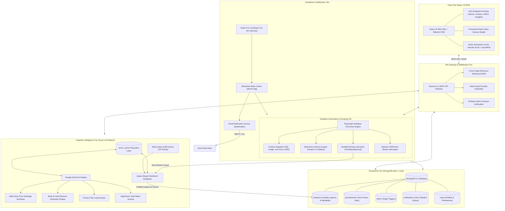
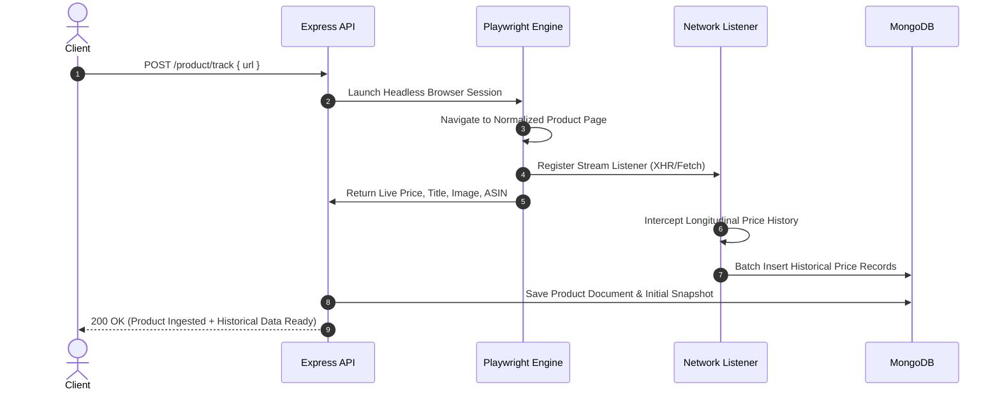
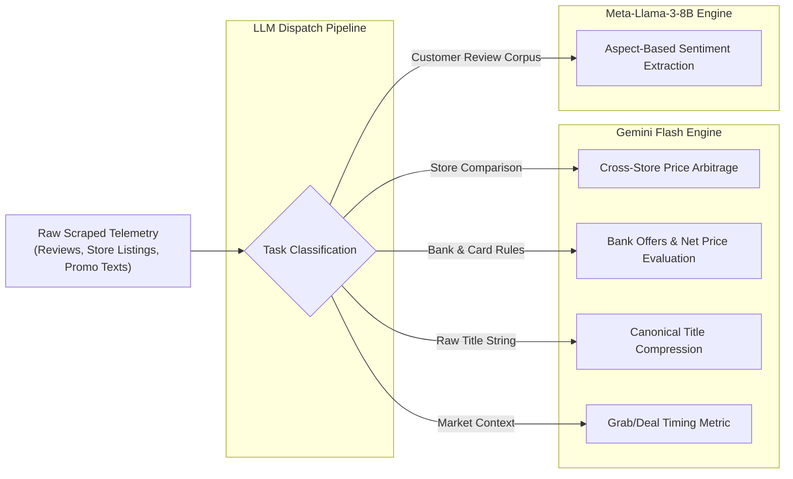
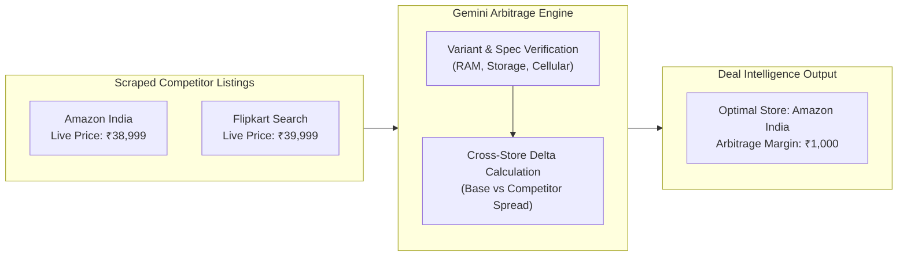
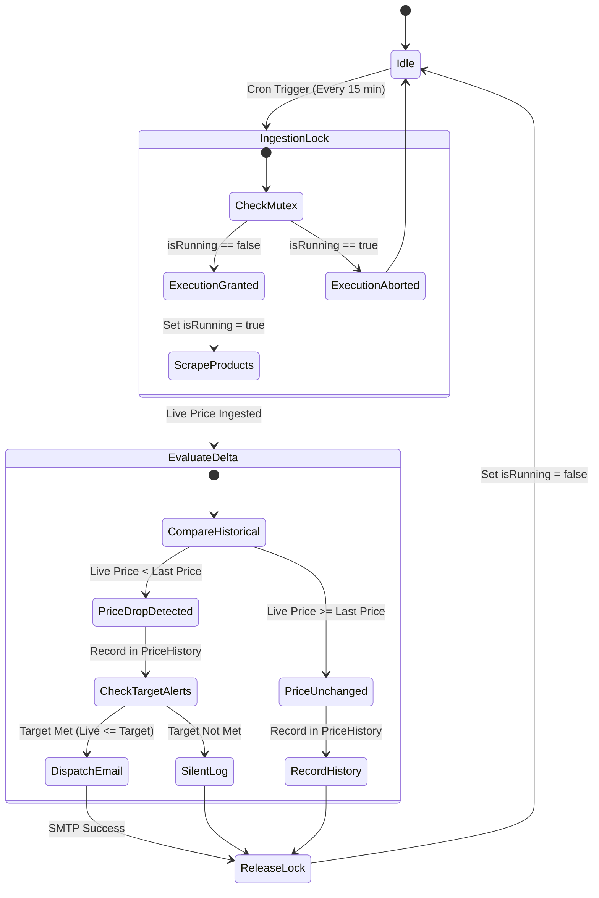
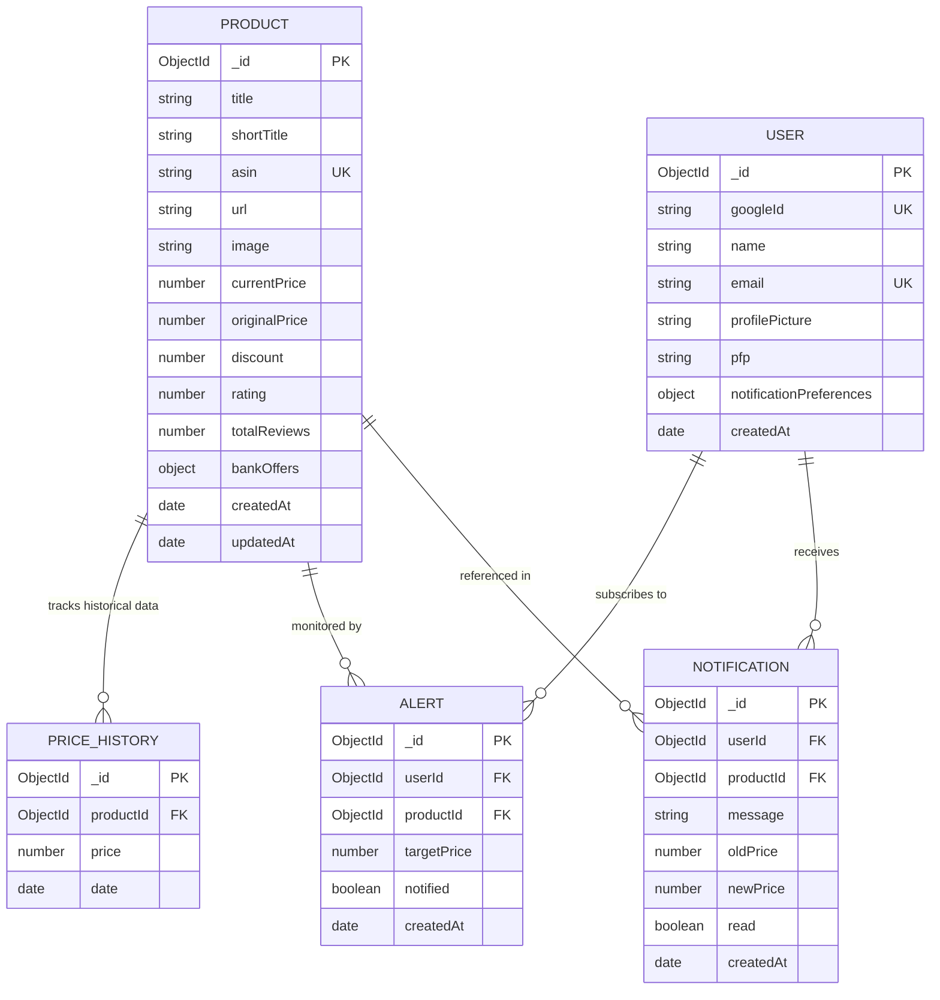

# Zemo

**Autonomous E-Commerce Price Intelligence, Cross-Store Arbitrage & Aspect-Based Sentiment Analysis Platform**

> Live Demo: [zemo-official.vercel.app](https://zemo-official.vercel.app)  
> Backend API: [zemo-backend.onrender.com](https://zemo-backend.onrender.com)

Zemo is a distributed e-commerce intelligence system engineered for automated web extraction, cross-retailer pricing arbitrage, historical price trajectory modeling, and large language model (LLM) cognitive distillation. The platform monitors high-turnover retail platforms (Amazon India, Flipkart), normalizes unstructured product metadata, reconstructs longitudinal pricing trends, and synthesizes aspect-level consumer sentiment and banking promotions into actionable consumer telemetry.

---

## Architectural Specification

| Dimension | Specification | Architecture Context |
| :--- | :--- | :--- |
| **API Runtime** | Node.js (v18+) / Express 5.x | Non-blocking asynchronous REST API gateway and request routing |
| **Persistence Engine** | MongoDB (v6+) / Mongoose 9.x | Document datastore for product catalogs, alerts, and time-series history |
| **Browser Automation** | Playwright 1.58 (Chromium) | Headless browser automation, DOM selector cascades, network stream interception |
| **Cognitive Intelligence** | Google Gemini API + Meta-Llama-3-8B | Dual-model LLM pipeline for price comparison, review aspect mining, bank discount logic |
| **Client Application** | React 19 / Vite 7 / Tailwind CSS | Single-page reactive interface, procedural canvas shaders, fluid audio engine |
| **Task Scheduling** | Node-Cron 4.2 | Mutex-guarded cron daemon executing periodic multi-threaded scraping |
| **Alert & Messaging** | Nodemailer / Abstract API | Transactional SMTP engine with multipart CID asset rendering |
| **Caching Layer** | Local High-Throughput JSON Store | Deterministic filesystem cache for zero-latency inference on critical demo products |
| **Target Retailers** | Amazon India (`amazon.in`), Flipkart (`flipkart.com`) | Canonical ASIN and FSN normalization pipelines |

---

## System Architecture

The following diagram illustrates the component topology and data lifecycle across client, gateway, automation, persistence, cognitive AI, and messaging tiers:



---

## Core Engineering Subsystems

### 1. Headless Browser Automation & Anti-Bot Mitigation
E-commerce retail domains rely on single-page JavaScript architectures, obfuscated class structures, and dynamic rendering mechanisms. 

- **Playwright Execution Engine**: Emulates native Chromium environments with tailored user-agent headers, viewpoint randomization, and locale settings to prevent fingerprint-based anti-bot blocks.
- **Selector Cascade Strategy**: Employs redundant XPath, CSS selector lists, and microdata attributes (e.g., `#priceblock_ourprice`, `.a-price .a-offscreen`, `[data-asin]`) to guarantee extraction reliability when DOM targets shift.
- **Resilient ASIN/FSN Resolution**: Normalizes raw, tracking-polluted referral URLs down to canonical identifiers:
  ```
  https://www.amazon.in/dp/B0GR64G4H6/ref=... -> B0GR64G4H6
  ```

### 2. Zero-Cold-Start Historical Backfill
Newly tracked items traditionally lack historical price points. Zemo circumvents this cold-start limitation by listening to and intercepting price-index network streams during initial product ingestion.



### 3. Multi-Store Cross-Retailer Price Discovery
When analyzing a product, the platform concurrently scouts alternative e-commerce platforms (Flipkart, Amazon) using clean title tokens generated by the AI title canonicalizer.

- **Dynamic Query Optimization**: Strips technical jargon, color codes, and SKU codes to execute targeted search queries on secondary platforms.
- **Fuzzy Token Matching**: Verifies that discovered listings match the primary item by validating RAM, storage, screen size, and model nomenclature before price differential calculation.
- **Direct Link Synthesis**: Ingests direct store URLs, shipping costs, and in-stock statuses across competing retailers.

### 4. Dual LLM Cognitive Intelligence Pipeline



#### Multi-Store Price Comparison Engine (`compareStoresAI.js`)
Normalizes prices across retail platforms, verifies variant specifications, extracts the lowest cross-store base price, and synthesizes structured arbitrage intelligence:



| Retailer | Detected Price | In Stock | Spread vs Baseline | Arbitrage Verdict |
| :--- | :--- | :--- | :--- | :--- |
| **Amazon India** | ₹38,999 | Yes | Baseline (₹0) | **Lowest Price Offering** |
| **Flipkart** | ₹39,999 | Yes | +₹1,000 | ₹1,000 Premium |

<details>
<summary>View Structured JSON API Payload</summary>

```json
{
  "bestStore": "Amazon",
  "lowestPrice": 38999,
  "stores": [
    {
      "store": "Amazon",
      "price": 38999,
      "inStock": true,
      "link": "https://www.amazon.in/dp/B0GR64G4H6",
      "differenceFromBase": 0
    },
    {
      "store": "Flipkart",
      "price": 39999,
      "inStock": true,
      "link": "https://www.flipkart.com/...",
      "differenceFromBase": 1000
    }
  ],
  "verdict": "Amazon is currently offering the lowest price with a ₹1,000 margin."
}
```

</details>


#### Bank Promotion & Effective Net Price Engine (`bankOffersAI.js`)
Parses complex unstructured discount strings (instant card discounts, cashback balances, no-cost EMI interest subventions, GST business credits) to compute the true out-of-pocket acquisition cost:
- **Instant Bank Discount**: Deducts upfront savings (e.g., "Flat ₹1,500 off on SBI Credit Cards").
- **Cashback Conversion**: Evaluates store balance credits (e.g., "5% cashback on Amazon Pay ICICI").
- **True Effective Net Price**:
  $$\text{Effective Price} = \text{Base Price} - \max(\text{Applicable Bank Discounts}) - \text{Cashback}$$

#### Aspect-Based Sentiment Mining (`reviewIntelligenceAI.js` / `aiAnalyzer.js`)
Aggregates customer reviews across positive and negative ratings. Distills qualitative feedback into aspect-level sentiment metrics:
- **Aspect Dimensions**: Display quality, battery endurance, build integrity, software stability, performance under load, and value for price.
- **Percentage Distribution**: Computes confidence ratios for each aspect based on verified purchase comments.

#### Algorithmic Grab / Deal Meter (`dealMeterAI.js`)
Computes an empirical deal rating on a scale from 0 to 100 based on:
- Deviation from all-time low price point.
- Proximity to mean historical pricing.
- Active bank promotional depth.
- Cross-retailer price spread.

### 5. High-Throughput Deterministic Caching Layer
To protect upstream API rate limits and eliminate cold-start latency for prospective recruiters and production visitors, Zemo integrates a local JSON caching layer (`/.zemo_cache`):
- `gemini_stores_cache.json`: Caches multi-store price comparisons.
- `gemini_offers_cache.json`: Caches bank discount breakdowns.
- `gemini_reviews_cache.json`: Caches aspect-based sentiment structures.
- `gemini_short_names_cache.json`: Caches clean canonical titles.
- `grab_meter_cache.json`: Caches deal scoring evaluations.

Live requests bypass external LLM roundtrips when valid cached keys exist, returning full telemetry payloads in sub-5ms intervals.

### 6. Mutex-Guarded Scheduler & Notification State Machine
Periodic price monitoring executes as an isolated background daemon via `node-cron`.



---

## Data Schemas & Entity Relationships



### Database Index Specifications

| Collection | Indexed Field(s) | Index Type | Optimization Target |
| :--- | :--- | :--- | :--- |
| `products` | `asin` | Unique Hash | O(1) deduplication during product URL ingestion |
| `products` | `createdAt` | Descending | Accelerated catalog pagination on Dashboard |
| `pricehistories` | `productId`, `date` | Compound | Rapid range queries for SVG price trajectory rendering |
| `alerts` | `productId`, `notified` | Compound | Fast filtering of pending alerts inside cron iteration |
| `users` | `googleId`, `email` | Unique | Identity verification and token resolution |

---

## REST API Specification

### Product & Intelligence Endpoints

| Method | Route | Description | Payload / Query Parameters |
| :--- | :--- | :--- | :--- |
| `POST` | `/product/track` | Normalizes URL and executes synchronous ingestion | `{ "url": "https://www.amazon.in/dp/..." }` |
| `GET` | `/product/list` | Returns paginated array of tracked products | Query: `?page=1&limit=20` |
| `GET` | `/product/:id` | Returns single product entity with latest metadata | URL Param: `id` (ObjectId) |
| `GET` | `/product/history/:id` | Returns time-series pricing trajectory | URL Param: `id` (ObjectId) |
| `GET` | `/product/compare-stores/:id` | Executes multi-store cross-retailer price comparison | URL Param: `id` (ObjectId) |
| `GET` | `/product/bank-offers/:id` | Evaluates card offers, EMI, and true net price | URL Param: `id` (ObjectId) |
| `GET` | `/product/customer-reviews/:id` | Distills review sentiment and aspect breakdowns | URL Param: `id` (ObjectId) |
| `GET` | `/product/deal-meter/:id` | Calculates empirical deal score (0-100) | URL Param: `id` (ObjectId) |
| `DELETE` | `/product/:id` | Removes product entity and associated history cascades | URL Param: `id` (ObjectId) |

### Price Alert Endpoints

| Method | Route | Description | Payload |
| :--- | :--- | :--- | :--- |
| `POST` | `/api/alerts/set` | Configures target threshold alert for user | `{ "userId": "...", "productId": "...", "targetPrice": 34999 }` |
| `GET` | `/api/alerts/user/:userId` | Retrieves active alert targets configured by user | URL Param: `userId` (ObjectId) |
| `DELETE` | `/api/alerts/:alertId` | Cancels specified threshold alert | URL Param: `alertId` (ObjectId) |

### Notification & User Endpoints

| Method | Route | Description | Payload / Headers |
| :--- | :--- | :--- | :--- |
| `POST` | `/user/google-login` | Synchronizes Firebase user identity | `{ "googleId": "...", "name": "...", "email": "..." }` |
| `GET` | `/user/:id` | Retrieves user profile and alert configuration | URL Param: `id` (ObjectId) |
| `PUT` | `/user/:id/preferences` | Updates notification dispatch preferences | `{ "emailAlerts": true, "pushAlerts": false }` |
| `GET` | `/api/notifications/:userId` | Returns historical notification dispatch log | URL Param: `userId` (ObjectId) |
| `PATCH` | `/api/notifications/mark-read` | Marks dispatch notification entries as read | `{ "notificationIds": ["..."] }` |

---

## Client Application Architecture

The frontend is structured as a responsive single-page application built on React 19, Vite 7, and Tailwind CSS.

### Routing Architecture

```
/
├── Landing Page (/)               # Procedural rain canvas shader, sound pill, hero entry
├── Dashboard / Radar (/radar)     # Tracked catalog, live search, card grid, instant modal
├── Store Arbitrage (/stores/:id)  # Side-by-side Amazon vs Flipkart price comparisons
├── Bank Offers (/offers/:id)      # Card discounts, cashback, EMI subventions, net price
├── Customer Reviews (/reviews/:id)# Aspect-based sentiment distillation, pros & cons
├── AI Insights (/insights/:id)    # Longitudinal price area graphs and volatility metrics
├── Wishlist (/wishlist)           # Saved target items with custom thresholds
└── User Profile (/profile)        # Account settings, custom avatar, dispatch logs
```

### Key Frontend Components

- **`RainyGlass.jsx`**: Procedural water droplet canvas system generating realistic rain refraction, droplet collision simulation, and background blur via direct HTML5 Canvas rendering.
- **`ProductNavTabs.jsx`**: Persistent analytical navigation bar enabling instantaneous switching between store comparison, review mining, bank discounts, and price history views.
- **`AiProgressLoader.jsx`**: Multi-phase progress visualizer providing step-by-step transparency during long-running background scraping and LLM synthesis operations.
- **`SoundPill.jsx`**: Ambient audio controller supporting synchronized rain ambience and musical backdrop with volume smoothing and user interaction gates.
- **`vercel.json`**: Rewrite configuration guaranteeing client-side routing support across all secondary view paths on Vercel deployments.

---

## Repository Structure

```
Zemo/
├── .env.example                     # Environment template for credentials and ports
├── .gitignore                       # Production ignore specifications (dist, node_modules, .env)
├── package.json                     # Monorepo root dependencies and orchestration scripts
├── package-lock.json                # Locked dependency tree
├── README.md                        # Primary engineering and architectural documentation
│
├── .zemo_cache/                     # Deterministic local cache for Gemini inference payloads
│   ├── gemini_offers_cache.json     # Bank offer deductions cache
│   ├── gemini_price_cache.json      # Dynamic price telemetry cache
│   ├── gemini_reviews_cache.json    # Distilled review aspects cache
│   ├── gemini_short_names_cache.json# Canonical titles cache
│   ├── gemini_stores_cache.json     # Multi-store price comparison cache
│   └── grab_meter_cache.json        # Grab meter deal evaluation cache
│
├── backend/                         # Express REST API & Automation Subsystem
│   ├── .env.example                 # Backend environment variable template
│   ├── server.js                    # Express application entrypoint and middleware setup
│   ├── assets/                      # Static email assets (brand logos)
│   ├── automation/                  # Playwright headless browser automation modules
│   │   ├── multiStoreScraper.js     # Live search and multi-retailer scraping engine
│   │   ├── priceFetcher.js          # Canonical product page extraction and selector cascades
│   │   ├── productMetadata.js       # ASIN resolution and metadata normalization
│   │   └── reviewScraper.js         # Stratified review collection engine
│   ├── controllers/                 # Route controllers
│   │   └── reviewController.js      # Review intelligence request handlers
│   ├── models/                      # Mongoose document schemas
│   │   ├── Alert.js                 # Threshold alert records
│   │   ├── Notification.js          # Dispatched notification history
│   │   ├── PriceHistory.js          # Time-series price snapshots
│   │   ├── Product.js               # Primary product catalog records
│   │   ├── reviewModel.js           # Review storage schemas
│   │   └── user.js                  # User accounts and preferences
│   ├── routes/                      # REST API routing definitions
│   │   ├── alertRoutes.js           # Target price alert routes
│   │   ├── authRoutes.js            # Authentication routes
│   │   ├── notificationRoutes.js     # User notification routes
│   │   ├── priceRoutes.js           # Price history retrieval routes
│   │   ├── productRoutes.js         # Ingestion, tracking, and list routes
│   │   ├── reviewRoutes.js          # Review distillation routes
│   │   └── userRoutes.js            # Profile and avatar upload routes
│   ├── scheduler/                   # Background task daemons
│   │   └── priceScheduler.js        # Reentrant 15-minute cron price monitor
│   ├── scripts/                     # Operational maintenance scripts
│   │   ├── importHistoryTest.js     # History import validation runner
│   │   ├── testScraper.js           # Isolated browser scraping tester
│   │   └── update_mongo_offers.js   # Demo offer synchronization helper
│   ├── services/                    # Cognitive AI and external communication services
│   │   ├── aiAnalyzer.js            # Meta-Llama sentiment inference driver
│   │   ├── bankOffersAI.js          # Gemini bank and payment discount processor
│   │   ├── compareStoresAI.js       # Gemini multi-store pricing arbitrage engine
│   │   ├── dealMeterAI.js           # Gemini deal timing and grab metric evaluator
│   │   ├── emailService.js          # Nodemailer transactional email dispatcher
│   │   ├── importPriceHistory.js    # Historical price data backfill processor
│   │   ├── productShortNameAI.js    # Gemini title canonicalization service
│   │   ├── reviewIntelligenceAI.js  # Gemini aspect-based review distillation
│   │   └── reviewProcessor.js       # Review text cleaning and aggregation
│   └── uploads/                     # User avatar upload directory (with .gitkeep)
│
├── frontend/                        # React 19 Client SPA
│   ├── eslint.config.js             # Client linter configuration
│   ├── index.html                   # HTML5 template and font preconnects
│   ├── package.json                 # Client dependencies and Vite scripts
│   ├── postcss.config.js            # PostCSS plugin configurations
│   ├── tailwind.config.js           # Tailored color system and typography tokens
│   ├── vercel.json                  # Client SPA routing rewrite rules for Vercel
│   ├── vite.config.js               # Vite build tool and plugin configuration
│   ├── public/                      # Static client distribution assets
│   │   ├── i_giorni.mp3             # Background acoustic soundtrack
│   │   ├── logo.png                 # Brand vector icon
│   │   ├── ludovico_einaudi.png     # Track thumbnail artwork
│   │   ├── rain_forest_bokeh.png    # Procedural canvas backdrop artwork
│   │   └── rain_loop.mp3            # Atmospheric rain audio sample
│   └── src/                         # Client React source code
│       ├── App.css                  # Component-specific stylesheet
│       ├── App.jsx                  # Main application layout, audio manager, router
│       ├── firebase.js              # Client Firebase SDK configuration
│       ├── index.css                # Global CSS directives, font imports, Lenis rules
│       ├── main.jsx                 # React root renderer
│       ├── components/              # Modular user interface components
│       │   ├── AiProgressLoader.jsx # Multi-phase loading state simulator
│       │   ├── EmailEntryModal.jsx  # Email subscription modal
│       │   ├── GoogleLoginButton.jsx# Google authentication button
│       │   ├── InsightMeter.jsx     # Aspect-based sentiment meter component
│       │   ├── NotificationBell.jsx # Notification dropdown trigger
│       │   ├── ProductCard.jsx      # Catalog product card with instant statistics
│       │   ├── ProductNavTabs.jsx   # Top-level sub-navigation tab switcher
│       │   ├── RainyGlass.jsx       # Procedural rain droplet HTML5 Canvas shader
│       │   └── SoundPill.jsx        # Floating atmospheric audio toggle
│       ├── pages/                   # Application view controllers
│       │   ├── BankOffersPage.jsx   # Card discounts and net price calculator
│       │   ├── CompareStoresPage.jsx# Cross-store arbitrage comparison view
│       │   ├── CustomerReviewsPage.jsx # Sentiment analysis and aspect metrics view
│       │   ├── Dashboard.jsx        # Tracked catalog, live monitoring, metrics
│       │   ├── InputTestingPage.jsx # Developer loader and console testing sandbox
│       │   ├── InsightsPage.jsx     # Price history graphs and volatility view
│       │   ├── LandingPage.jsx      # High-impact entry page with procedural canvas
│       │   ├── LoginPage.jsx        # Authentication view
│       │   ├── ProfilePage.jsx      # Account settings and notification controls
│       │   └── WishlistPage.jsx     # User saved target items view
│       └── services/                # HTTP API integration clients
│           └── api.js               # Central Axios client with dynamic base URL
└── uploads/                         # Root uploads directory (with .gitkeep)
```

---

## Environment Configuration

Configure the application by establishing a `.env` file at the root directory. Use the provided [`.env.example`](.env.example) template:

| Variable | Type | Required | Description |
| :--- | :--- | :--- | :--- |
| `PORT` | Number | Yes | Port on which the Express REST API listens (Default: `5000`) |
| `MONGO_URI` | String | Yes | MongoDB connection URI (`mongodb://localhost:27017/zemo` or Atlas URI) |
| `GEMINI_API_KEY` | String | Yes | Google Gemini API key for store comparison, bank offers, and review intelligence |
| `HF_API_KEY` | String | Optional | Hugging Face user token for Meta-Llama-3 aspect sentiment extraction |
| `EMAIL_USER` | String | Yes | SMTP sender username / Gmail address for price drop alerts |
| `EMAIL_PASS` | String | Yes | SMTP app-specific password (e.g., Google App Password) |
| `NOTIFICATION_EMAIL`| String | Yes | Default administrative notification recipient address |
| `ABSTRACT_EMAIL_API_KEY` | String | Optional | Abstract API key for deliverability and MX record validation |

For frontend deployments (e.g., Vercel), configure the environment variable:

| Variable | Target | Description |
| :--- | :--- | :--- |
| `VITE_API_URL` | Frontend (`frontend/.env`) | Deployed backend base URL (e.g., `https://api.yourdomain.com`). Falls back to `http://localhost:5000` locally. |

---

## Local Installation & Setup

### Prerequisites
- Node.js (v18.0.0 or higher)
- npm (v9.0.0 or higher)
- MongoDB instance (local or MongoDB Atlas connection string)
- Playwright Chromium dependencies

### Installation Steps

1. **Clone the repository**:
   ```bash
   git clone https://github.com/imMohammedSahil/Zemo.git
   cd Zemo
   ```

2. **Install root and backend dependencies**:
   ```bash
   npm install
   ```

3. **Install client frontend dependencies**:
   ```bash
   cd frontend
   npm install
   cd ..
   ```

4. **Install Playwright browser binaries**:
   ```bash
   npx playwright install chromium
   ```

5. **Configure environment variables**:
   ```bash
   cp .env.example .env
   # Edit .env with your MongoDB credentials, Gemini API key, and SMTP parameters
   ```

6. **Start the development environment**:
   ```bash
   npm run dev
   ```
   This command executes `concurrently`, spinning up:
   - Backend API server on `http://localhost:5000` (with live reload via `--watch-path=backend`)
   - Frontend Vite development server on `http://localhost:5173`

---

## Deployment Configuration

### Frontend Deployment on Vercel
The frontend is decoupled and configured for zero-configuration Vercel deployment:
1. Connect the repository to Vercel.
2. Set **Root Directory** to `frontend`.
3. Set **Framework Preset** to `Vite`.
4. Add the environment variable:
   ```
   VITE_API_URL = https://your-backend-api-url.com
   ```
5. Deploy. The included [`frontend/vercel.json`](frontend/vercel.json) rewrite rule handles client-side React Router navigation seamlessly without 404 errors on direct sub-path access.

### Backend Deployment (Render, Railway, Fly.io, or AWS EC2)
1. Ensure the host environment provides Chromium dependencies required by Playwright (`npx playwright install-deps` or Dockerized container).
2. Configure all environment variables specified in `.env.example`.
3. Start the production server:
   ```bash
   npm run start
   ```

---

## License

This software is released under the [MIT License](LICENSE).
