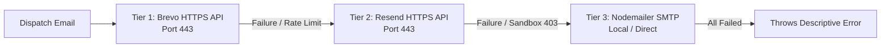

# resilient-mail-failover 🛡️✉️

> Zero-downtime, multi-provider email dispatcher for Node.js. Automatically bypasses cloud egress SMTP port blocks (Render, Vercel, Railway, AWS) by cascading **Brevo HTTPS (Port 443) ➔ Resend HTTPS (Port 443) ➔ Nodemailer SMTP**.

[](https://www.npmjs.com/package/resilient-mail-failover)
[](LICENSE)

---

## The Problem

When deploying backend services to modern cloud providers like **Render, Vercel, Railway, or AWS EC2**, outbound SMTP ports (`25`, `465`, `587`) are often blocked by default to prevent spam. 

Traditional `nodemailer` scripts time out with `ETIMEDOUT`. Meanwhile, modern APIs like Resend in free-tier sandbox mode will throw `403` errors if you attempt to send an email to unverified recipients without custom domain DNS records configured.

## The Solution: Automatic Tiered Cascading



---

## Installation

```bash
npm install resilient-mail-failover
```

---

## Quickstart

```javascript
const ResilientMailer = require("resilient-mail-failover");

const mailer = new ResilientMailer({
  // Provide any or all credentials - the engine cascades automatically!
  brevoApiKey: process.env.BREVO_API_KEY,
  resendApiKey: process.env.RESEND_API_KEY,
  senderEmail: "alerts@myproject.com",
  senderName: "My App Alerts",
  smtpUser: process.env.SMTP_USER,
  smtpPass: process.env.SMTP_PASS
});

async function sendWelcomeEmail() {
  const result = await mailer.send({
    to: "customer@example.com",
    subject: "Welcome aboard!",
    html: "<h1>Welcome!</h1><p>Your account is ready.</p>"
  });

  console.log(`Delivered via ${result.provider} (ID: ${result.messageId})`);
}

sendWelcomeEmail();
```

---

## Environment Variable Auto-Discovery

If you don't want to pass options explicitly, `ResilientMailer` will automatically read from standard environment variables:

* `BREVO_API_KEY`
* `RESEND_API_KEY`
* `EMAIL_USER` or `SMTP_USER`
* `EMAIL_PASS` or `SMTP_PASS`
* `SMTP_HOST` & `SMTP_PORT`

```javascript
const mailer = new ResilientMailer(); // Reads from process.env automatically
await mailer.send({ to: "user@domain.com", subject: "Ping", html: "Pong" });
```

---

## License

MIT © [Mohammed Sahil](https://github.com/imMohammedSahil)
Extracted from the production-hardened messaging architecture of [Zemo](https://github.com/imMohammedSahil/Zemo).

